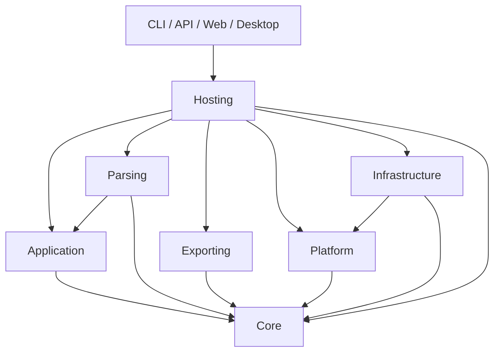

# Core 模块拆分与迁移

更新日期：2026-10-18。对应 Core 优化第 9 项。

## 已落地的项目边界

旧 Core 同时承载计算、文件和数据库解析、PDF/Excel、Roslyn、SQLite 平台存储以及完整命令编排。现在拆为七个真实项目，均加入解决方案；没有通过链接源码把外层实现重新编入内核。

| 项目 | 职责 | 直接项目引用 | 第三方依赖 |
|---|---|---|---|
| ObjectAnalyzer.Core | 值和路径、统计状态、分析器和规则、Schema 推断、质量指标、PII/结果投影、输入数据契约 | 无 | 无 |
| ObjectAnalyzer.Application | 执行计划、运行上下文、阶段管线、事件、采样、预览、输入与转换端口 | Core | 无 |
| ObjectAnalyzer.Parsing | 文件与数据库输入、压缩、解析器注册、JSONPath、字段解密转换 | Core、Application | 数据库驱动、MiniExcel、SharpZipLib、YamlDotNet、JsonPath、BouncyCastle |
| ObjectAnalyzer.Exporting | 各报告和 Schema 后端、快照文件 IO、C# 源码规则导入 | Core | MiniExcel、QuestPDF、Roslyn |
| ObjectAnalyzer.Platform | 作业生命周期、运行注册、历史查询端口、质量基线、责任、修复、告警及交付模型 | Core | 无 |
| ObjectAnalyzer.Infrastructure | SQLite 历史/基线/责任/修复/告警存储，审计文件和 KMS 实现 | Core、Platform | Microsoft.Data.Sqlite、SQLite 原生库 |
| ObjectAnalyzer.Hosting | 完整命令、预检、续跑文件、报告与门禁编排、默认执行器工厂、DI 注册 | 上述六个项目 | DI 抽象 |

箭头表示调用方引用被调用方：



Core 和 Application 不引用具体解析器、数据库、报告后端、平台业务或宿主。Platform 通过存储接口调用具体实现，接口由平台定义，Infrastructure 实现。Hosting 与四个宿主是组合根；AddAnalysisPlatform 的注册实现位于 Hosting。

拆分保留大多数现有命名空间，命名空间不等同于程序集：例如 SourceRecord 仍在 ObjectAnalyzer.Parsing 命名空间，但属于 Core 的输入契约。部分模块间使用显式 InternalsVisibleTo 保留内部状态/预算桥接，不将其扩成公共 API，也不产生反向程序集引用。

## 最小内存分析应用

只引用计算内核即可进行统计、规则检查、Schema 推断和结果投影，不会引入数据库驱动、PDF、解析器或作业平台。

```xml
<ProjectReference Include="../../src/ObjectAnalyzer.Core/ObjectAnalyzer.Core.csproj" />
```

```csharp
using ObjectAnalyzer.Analysis;
using ObjectAnalyzer.Data;

var state = new AnalysisAccumulator();
foreach (var amount in new[] { 10, 20, 30 })
    state.Observe(new Dictionary<FieldPath, RecordValue>
    {
        [FieldPath.Parse("amount")] = RecordValue.FromObject(amount)
    });
var result = state.Complete();
var schema = SchemaInference.Infer(result);
```

可运行示例见 [ObjectAnalyzer.MemorySample](../samples/ObjectAnalyzer.MemorySample/Program.cs)：

```powershell
dotnet run --project samples/ObjectAnalyzer.MemorySample
```

预期输出：`records=3, average=20, schema=schema-model/v1`。运行依赖清单只有示例自身和 Core；Core NuGet 包的 net10.0 依赖组为空。

## 应用管线与输入端口

需要执行阶段、事件、采样、取消和预览时，引用 Application。AnalysisExecutor 显式接收 IAnalysisInputServices，该端口负责：

- 根据配置打开 IAnalysisDataSource，可接受 IRecordParserRegistry 扩展。
- 验证并执行记录级 JSONPath 投影。
- 提供压缩输入的诊断信息。
- 创建 IRecordTransformer，执行字段选择、转换、过滤并回填失败计数。

AnalysisRunContext.Source 可以直接提供内存或自定义数据源。Application 不负责自动寻找第三方适配器；可自行实现端口，或使用 Parsing 的 DefaultAnalysisInputServices。同步与异步输入桥接仍归 Application 管理，保持有界队列、取消和每次运行状态隔离。

```csharp
// 引用 Application 与自己的端口实现：
var executor = new AnalysisExecutor(myInputServices, myProgressReporter);
var run = executor.Execute(options, rules, runContext, cancellationToken);

// 使用 Hosting 的全部内置输入能力：
var builtIn = AnalysisRuntime.CreateExecutor(myProgressReporter);
var result = await builtIn.ExecuteAsync(options, rules, runContext, cancellationToken);
```

JSONPath 的具体语法验证现在由输入端口在执行准备阶段完成，仍早于打开输入。AnalysisExecutionPlan 保留与适配器无关的参数校验、配置冻结及资源描述。构造计划本身不会加载 JSONPath 实现。

## 解除的反向依赖

质量指标 QualityMetrics、QualityMetricsCalculator、QualityScoreCalculator 从平台移入 Core，命名空间改为 ObjectAnalyzer.Analysis。质量门禁无需引用平台实体；平台继续消费同一份评分结果，公式不变。

ResultProjection 保留通用结果投影，作业投影移动为 Platform 的 JobResultProjection.Job。API 和测试同步更新。它仍复制并投影交付数据，不改写历史存储中的 ResultJson。

AnalysisJobRegistry 从原 Core 的 Preflight 目录移入 Platform。完整 AnalysisCommandRunner、AnalysisRunner、AnalysisPipeline 便捷入口和预检文件逻辑移入 Hosting。SchemaSnapshotExporter、DistributionSnapshotExporter 的文件读写归入 Exporting，快照模型和比较算法保留在 Core。

## 迁移影响

这是程序集边界的破坏性调整，已有二进制调用方需要重新编译；没有增加类型转发兼容壳。

- 只引用旧 Core 就能调用全部功能的方式不再成立。调用者按需引用对应项目；四个宿主已显式添加所需引用。
- `new AnalysisExecutor()` 改为 `AnalysisRuntime.CreateExecutor()`，或 `new AnalysisExecutor(inputServices, progress)`。
- `AnalysisRunContext.Parsers` 改为 IRecordParserRegistry，现有 RecordParserRegistry 实例可直接赋值。
- `ResultProjection.Job(job)` 改为 `JobResultProjection.Job(job)`，需要引用 Platform。
- 质量评分类型使用 ObjectAnalyzer.Analysis 命名空间。
- 静态 Schema/报告方法和完整命令入口的源码名称基本保留，但所属程序集改变。

本次不修改统计公式、字段值语义、数据库表结构、analysis-state/v3、检查点或 SchemaSnapshot v2 的存储协议。现有状态恢复、结果投影和平台生命周期测试继续验证这些行为。

## 验证

- Debug、Release 完整解决方案构建通过，零警告、零错误，包含 CLI、API、Web、Desktop 及独立内核示例。
- 新增 ArchitectureBoundaryTests 共 7 项：约束直接项目引用、领域项目无包/框架依赖、关键类型程序集归属、内核运行引用，以及自定义内存端口执行和打开输入前验证。
- Release 综合回归 799/801；两项失败仍为已有的 SqliteQualityBaselineStoreTests.SaveGetAndDelete_Works 与 Save_ExistingSource_UpdatesBaseline 临时数据库文件锁问题。
- API 132/132、Web 74/74；CLI 启动成功；仅引用 Core 的示例运行成功。
- Core 独立 NuGet 打包与 CLI 工具打包成功，工具包包含拆出的七个模块，产物只写入本地 artifacts。
- CI 增加独立内核示例运行，Desktop 工作流路径覆盖新增模块、共享构建配置与解决方案。

```powershell
dotnet build ObjectAnalyzer.sln -c Release
dotnet test tests/ObjectAnalyzer.Tests --no-build -c Release
dotnet test tests/ObjectAnalyzer.Api.Tests --no-build -c Release
dotnet test tests/ObjectAnalyzer.Web.Tests --no-build -c Release
dotnet run --project samples/ObjectAnalyzer.MemorySample --no-build -c Release
dotnet pack src/ObjectAnalyzer.Core -c Release --no-build -o artifacts/packages
dotnet pack src/ObjectAnalyzer -c Release --no-build -o artifacts/packages
```
